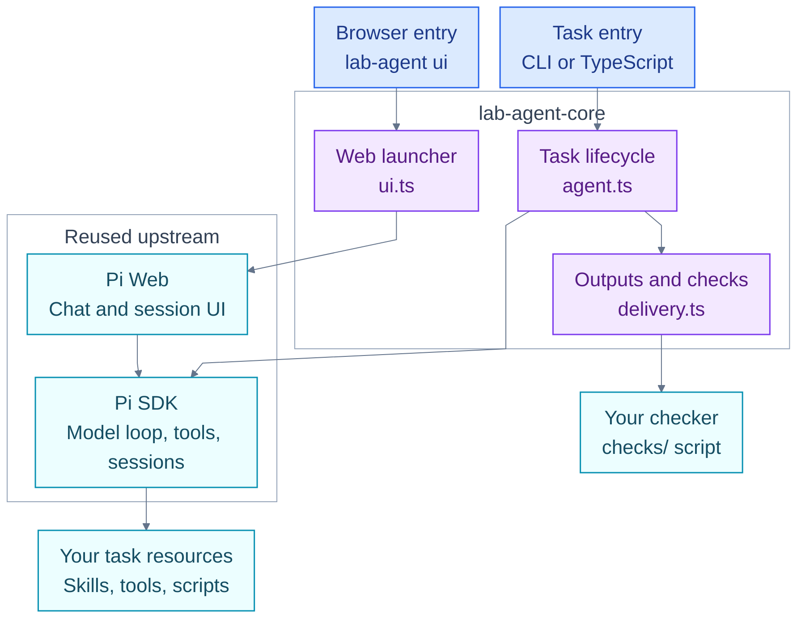

# lab-agent-core

A shared starting point for independent lab Agents, built on Pi SDK. Install this
package in each application, then add that application's instructions, tools and
delivery checks. A paper-collection Agent and a protein-design Agent can use the
same runtime package while keeping their own data and scientific requirements.

**Pi runs the Agent. lab-agent-core organizes the project and its deliveries.
Your application defines the scientific task and what counts as a usable result.**

| Owner | Responsibility | Example |
| --- | --- | --- |
| Pi SDK / Pi Web | Model and tool loop, context, skills, extensions, native sessions and browser chat | Ask a model to use a tool; save and resume a conversation |
| This package | Project startup, CLI, model-selection commands, run directories and external checker execution | Run a task, collect output paths, then invoke a checker |
| Your Agent project | Domain instructions, tools, scripts, workflows, inputs and acceptance criteria | Collect measurements with sources; check that each value has a unit |

## Architecture

This diagram answers **which code owns each part of execution**. Arrows show
calls or delegation; the Pi node represents the shared SDK, not one shared live
session. Purple nodes are the small layer maintained in this repository.



There are two execution paths:

- **Task run:** `lab-agent run` → `createAgent()` → `agent.run()` → native Pi
  execution → output indexing → optional delivery check.
- **Browser chat:** `lab-agent ui` → upstream Pi Web → native Pi sessions. It
  shares filesystem configuration and project resources, but does not call
  `agent.run()` or automatically create a Core run or invoke its checker.

### Where is the backend?

There are two things to distinguish: **the HTTP server** and **the Agent execution
engine**. Pi Web ships both browser assets and a Next.js HTTP backend. That backend
uses Pi SDK in its server process. CLI runs call Pi SDK directly in the CLI
process; they do not need an HTTP server.

```text
Browser chat
  Browser
    → Pi Web HTTP API (local Next.js server, default port 30141)
    → Pi Web session management
    → Pi SDK: AgentSession → model/tool loop → provider API + local tools
    ← streamed events through /api/agent/<id>/events (SSE)

CLI task
  lab-agent run
    → src/cli.ts → src/agent.ts
    → Pi SDK: AgentSession → model/tool loop → provider API + local tools
    → src/delivery.ts → your checker → run/check records
```

The installed backend code is in these dependency directories:

| Installed path under `node_modules/` | Role |
| --- | --- |
| `@agegr/pi-web/.next/server/app/api/` | Compiled HTTP routes, including session creation, commands, events and files |
| `@agegr/pi-web/.next/server/chunks/` | Compiled server implementation, including native Pi session management |
| `@earendil-works/pi-coding-agent/dist/core/` | Agent sessions, resource loading and native conversation persistence |
| `@earendil-works/pi-agent-core/dist/` | Model/tool execution loop |
| `@earendil-works/pi-ai/dist/` | Model-provider adapters and streaming |

These are installed upstream implementations. Our [ui.ts](src/ui.ts) launches
Pi Web's server; our [agent.ts](src/agent.ts) calls Pi SDK for CLI/SDK task runs.
**The browser's HTTP API currently belongs to Pi Web; it does not route through
our `agent.run()` delivery lifecycle.** A browser button that runs application
tasks with Core delivery checks would need an HTTP handler that calls
`agent.run()`; that application endpoint is not implemented in v0.1.

### What happens during one task?

For `lab-agent run "Collect measurements from this paper"`:

1. [cli.ts](src/cli.ts) loads `agent.config.ts` through [config.ts](src/config.ts),
   applies model selection and optionally opens an existing native session.
2. [agent.ts](src/agent.ts) creates the Pi session and binds project extensions.
   `agent.run()` creates a delivery directory and tells Pi where to save outputs.
3. **Pi** performs the model/tool loop using the project's instructions and
   resources. Tools can call existing Python scripts or external programs.
4. When execution completes, [delivery.ts](src/delivery.ts) lists actual output
   files and runs the configured checker. Without a checker, delivery remains
   `not_checked`. Failed or aborted execution skips automatic checking.
5. The CLI prints the result and disposes the session, including native shutdown
   hooks. `lab-agent check runs/<id>` can later rerun only the checker.

```text
my-agent/runs/<run-id>/
├── output/          Deliverable files written by the Agent's tools
├── run.json         Task, execution/delivery states, model, session reference, output paths
├── check.json       Checker report, when a checker runs
└── validation.log   Checker stdout/stderr, when a checker runs
```

`execution: completed` means the model/tool execution finished; `delivery: passed`
means the application's checker accepted the output. These are separate facts.
The native Pi session stores conversation history; `run.json` references it.
A failed check is reported to the caller; v0.1 does not automatically ask the
model to repair the result or resume an external scientific job.

## Where to find each feature

These are **all nine source files** in this package. Start with `config.ts` for
the small public contract, then `agent.ts` and `delivery.ts` for the task path.

| Feature / question | File | What it does |
| --- | --- | --- |
| What can an application import? | [src/index.ts](src/index.ts) | Public exports: configuration, Agent creation, run/check types and `checkRun()` |
| What belongs in `agent.config.ts`? | [src/config.ts](src/config.ts) | Defines `root` and optional checker command/timeout; loads the TypeScript config |
| How does a task start, finish or stop? | [src/agent.ts](src/agent.ts) | Creates the native session, runs tasks, records failures, exposes `agent.session`, and cleans up |
| Where are outputs and acceptance results stored? | [src/delivery.ts](src/delivery.ts) | Creates run records, indexes output files, executes checkers and supports rechecking |
| How do I inspect or change models? | [src/models.ts](src/models.ts) | Reads native configuration, lists models, validates IDs and saves project/user defaults |
| How are shell commands connected? | [src/cli.ts](src/cli.ts) | Dispatches `run`, `check`, `ui`, `init`, `config`, `models`, `use`; handles run model precedence and exit codes |
| Where is the browser UI implemented? | [src/ui.ts](src/ui.ts) | Launches installed Pi Web for the project and forwards shutdown signals; UI implementation lives upstream |
| How is a new project generated? | [src/scaffold.ts](src/scaffold.ts) | Copies the minimal template into an empty directory and sets its name/dependency |
| What is `create-lab-agent`? | [src/create.ts](src/create.ts) | Small executable calling the same scaffolder as `lab-agent init` |

## What to write for a new Agent

**Create a separate application that depends on this package.** For example,
`paper-agent/` owns its paper extraction rules and datasets; it does not need a
copy of `src/agent.ts`. The generated template supplies the root files below;
add the optional directories as the task needs them.

```text
paper-agent/                         Independent application
├── package.json                    Dependency and launch commands
├── agent.config.ts                 Project root and optional checker command
├── AGENTS.md                       Task instructions and working rules
├── .pi/
│   ├── settings.json               Project model/resource settings
│   └── extensions/                 Custom Pi tools and hooks
├── .agents/skills/<name>/SKILL.md   Reusable task instructions
├── scripts/                        Existing Python/CLI programs
├── workflows/                      Explicit stages or external-job recovery, if needed
├── checks/                         Domain-specific acceptance scripts
├── data/                           Application inputs
└── runs/                           Generated deliveries
```

| You want to… | Add or change in your application |
| --- | --- |
| Teach an Agent how to extract a paper's measurements | `AGENTS.md` and a skill under `.agents/skills/` |
| Let it call a protein predictor | A script under `scripts/`; optionally expose it as a structured tool in `.pi/extensions/` |
| Require sequence, value, unit and source to match | A checker under `checks/`, configured in `agent.config.ts` |
| Enforce stages, wait for a cluster job or recover its job ID | Application code under `workflows/`, using native session APIs as needed |
| Change model or API endpoint | Native Pi settings and provider configuration described below |

Skills describe **how to work**. Tools/scripts provide **actions**. Workflow code
enforces **sequence and recovery**. Checkers decide **whether outputs are usable**.
They remain application responsibilities; the shared package executes them through
Pi and the delivery-check contract.

### Which configuration file should I edit?

| File | Purpose |
| --- | --- |
| `<project>/agent.config.ts` | Project root and optional delivery checker; no separate provider schema |
| `<project>/.pi/settings.json` | Project defaults, including selected provider/model and native resource settings |
| `<agent-dir>/settings.json` | User defaults inherited by projects |
| `<agent-dir>/models.json` | Custom provider endpoints, API dialects, model catalogs and credential references |
| `<agent-dir>/auth.json` or environment variables | Credentials |

`<agent-dir>` defaults to `~/.pi/agent`; `PI_CODING_AGENT_DIR` overrides it.
Run these commands inside the generated project:

```sh
npx lab-agent config                           # Inspect paths and effective defaults
npx lab-agent models --all                     # Inspect the model catalog
npx lab-agent use <provider> <model-id>         # Save project defaults
npx lab-agent run "Your task" --provider <provider> --model <model-id>
```

For CLI task runs, selection is **explicit flags → restored session → project
defaults → user defaults**. Named selections must be available; the CLI fails
instead of silently switching providers. SDK/UI startup follows native Pi
behavior. See [providers and models](docs/MODELS.md) for credentials, custom
endpoints, exact selection and changing an existing UI session.

## Install and run

Requires Node.js **22.19+**. The package is `lab-agent-core`; its executables are
`lab-agent` and `create-lab-agent`. This repository does not imply npm publication.

```sh
npm ci
npm pack
```

Create an independent project from the resulting tarball:

```sh
npm exec --package=/absolute/path/lab-agent-core-0.1.0.tgz -- create-lab-agent my-agent
cd my-agent
npm install /absolute/path/lab-agent-core-0.1.0.tgz
npm run run -- "Read AGENTS.md and summarize the project"
npm run ui
```

Configure a Pi model/provider before running inference; see
[providers and models](docs/MODELS.md) for model selection, custom endpoints and
project/global defaults. See the
[Quickstart](docs/QUICKSTART.md) for setup, native extensions, Python and validation,
and the [conventions](docs/CONVENTIONS.md) for project boundaries and run semantics.

```ts
import { createAgent, defineAgent } from 'lab-agent-core';

const agent = await createAgent(defineAgent({ root: process.cwd() }));
try {
  const result = await agent.run('Analyze input files and save the results');
  console.log(result.execution, result.delivery, result.artifacts);
  await agent.session.prompt('Explain the limitations'); // Native Pi; no Core check
} finally {
  await agent.dispose();
}
```

No checker means `not_checked`, even when inference finishes successfully. Native
session operations and UI chats do not automatically invoke Core delivery checks.
`dev` aliases `ui`; it does not watch files. Pi Web runs on loopback for a trusted
local project. Do not write the same Pi session from SDK and UI concurrently.

## Templates, tests and supporting files

| Files | Purpose |
| --- | --- |
| [templates/minimal/](templates/minimal/) | Starter application: `package.json` supplies commands; `agent.config.ts` sets the root; `AGENTS.md` supplies starter instructions; `README.md` explains startup; `gitignore` becomes `.gitignore` |
| [tests/unit/agent.test.mjs](tests/unit/agent.test.mjs) | Native session execution, tools/extensions, failure and cleanup behavior |
| [tests/unit/delivery.test.mjs](tests/unit/delivery.test.mjs) | Checker reports, timeouts, rechecks and output indexing |
| [tests/unit/models.test.mjs](tests/unit/models.test.mjs) | Configuration, defaults, model precedence and rejected selections |
| [tests/consumers/packed.test.mjs](tests/consumers/packed.test.mjs) | Installs the actual tarball in independent TypeScript/Python consumer projects |
| [tests/ui.test.mjs](tests/ui.test.mjs) | Runs real Pi Web and exercises chat, tools, sessions, files and project defaults |
| [tests/fixtures/model-server.mjs](tests/fixtures/model-server.mjs) | Deterministic local model endpoint for integration tests; not evidence of real-model reasoning quality |
| [package.json](package.json), [package-lock.json](package-lock.json) | Public package entry points, commands and pinned dependency resolution |
| [tsconfig.json](tsconfig.json), [.gitignore](.gitignore), [LICENSE](LICENSE) | TypeScript build settings, generated-file exclusions and MIT license |
| [.github/workflows/check.yml](.github/workflows/check.yml) | CI verification and package artifact build |

`dist/` is generated JavaScript and type declarations; edit `src/` and rebuild.
`node_modules/` contains installed upstream code. Neither is application source.
`npm run verify` runs type checks, unit, UI and consumer tests; `npm pack` builds
the distributable. Consumer tests exercise an installed tarball, not workspace
source links.

| Read next | What it explains |
| --- | --- |
| [Quickstart](docs/QUICKSTART.md) | Build a first Agent, add tools/Python and wire a checker |
| [Conventions](docs/CONVENTIONS.md) | Application layout, API boundaries and delivery/report contract |
| [Models](docs/MODELS.md) | Providers, credentials, configuration precedence and switching models |
| [Implementation](docs/IMPLEMENTATION.md) | Implementation decisions and scope |
| [Validation](docs/VALIDATION.md) | Verified behavior, release checks and remaining limits |

Upstream: [Pi SDK](https://pi.dev/docs/latest/sdk),
[Extensions](https://pi.dev/docs/latest/extensions),
[Packages](https://pi.dev/docs/latest/packages),
[Pi Web](https://github.com/agegr/pi-web).
