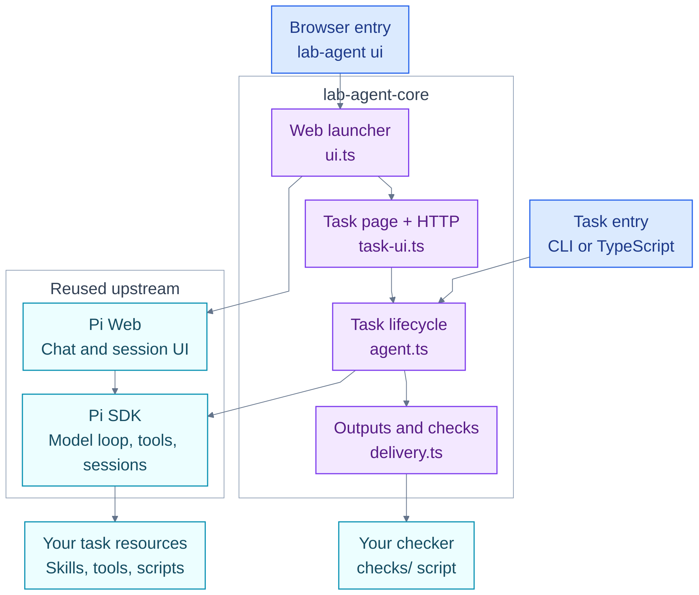

# Architecture and implementation

Package/project name: `lab-agent-core`; executables remain `lab-agent` and
`create-lab-agent`. Model/provider configuration follows native Pi files. CLI
`models`, `use`, `config`, and per-run `--provider/--model` are conveniences over
that format, not a second provider protocol. See MODELS.md for selection scopes.

One package supplies the shared lifecycle while exposing native Pi session APIs.
This reference covers contracts, execution paths and the source map. For a first
Agent, start with the [Quickstart](QUICKSTART.md).

- Node >=22.19; Pi packages exactly 1.2.0; Pi Web 0.12.2. Pi's sibling packages are pinned together because they otherwise use caret dependencies. UI and Core must share the same native session format.
- `defineAgent({root, validation?})`; `createAgent(config, nativeOptions?)`. Native options are Pi `CreateAgentSessionOptions` except `cwd`, which is the project root. UI uses native project configuration, not programmatic in-memory overrides.
- Supply Pi's native MCP/codemode/tool-search factories through the default resource loader and honor native exclusions/replacements. No custom MCP protocol or tool registry. Advanced callers can supply a native resourceLoader. Async `dispose()` awaits abort and native extension shutdown before invalidating the session.
- `run(task)` creates `runs/<timestamp>-<random-id>/output`, prompts Pi with that location, waits for native `prompt()` completion, records output files, then invokes the optional checker. No custom agent loop or retry policy.
- Run execution (`running/completed/failed/aborted`) and delivery (`not_checked/passed/partial/failed`) are independent. No checker means `not_checked`, never implicit success.
- Checker runs an argv array without a shell, with project cwd and `AGENT_ROOT`, `AGENT_RUN_DIR`, `AGENT_OUTPUT_DIR`, `AGENT_CHECK_FILE`. It writes `check.json` with status, checks and issues. Nonzero exit, timeout, missing or malformed report means failed delivery. Rechecks remove the old report first.
- Native Pi JSONL remains the conversation/event source; Core stores only its run record and checker log, without duplicating the transcript or hashing outputs.
- Runs on a session are sequential. Native session operations bypass automatic delivery checks. File-producing jobs and side-effect recovery remain the application's responsibility.
- The local task page runs the Core delivery path and links to upstream Pi Web for native chat. Both listeners use loopback. Chat itself does not create Core delivery records.
- Trusted local project only; no sandbox/multi-user service claim. SDK and UI cannot concurrently mutate the same session.

Acceptance cases: real Pi runtime with a deterministic local HTTP model fixture; extensions, skills, tool execution, native persistence, packed external consumers, Python workflow, checker failures, and upstream UI endpoints. Real paid-provider inference is reported separately from these engineering checks.

## Architecture

This diagram answers **which code owns each part of execution**. Arrows show
calls or delegation; the Pi node represents the shared SDK, not one shared live
session. Purple nodes are the small layer maintained in this repository.



There are three entry paths:

- **Task run:** `lab-agent run` → `createAgent()` → `agent.run()` → native Pi
  execution → output indexing → optional delivery check.
- **Browser task:** task page → `task-ui.ts` → `createAgent()` / `agent.run()` →
  the same run records, actual output files and configured checker.
- **Browser chat:** task page's chat link → upstream Pi Web → native Pi sessions. It
  shares filesystem configuration and project resources, but does not call
  `agent.run()` or automatically create a Core run or invoke its checker.

### Where is the backend?

There are two things to distinguish: **the HTTP server** and **the Agent execution
engine**. Pi Web ships both browser assets and a Next.js HTTP backend. That backend
uses Pi SDK in its server process. CLI runs call Pi SDK directly in the CLI
process; they do not need an HTTP server. The task page has a small local Node
HTTP adapter in `task-ui.ts` that calls the Core API directly.

```text
Browser task
  Task page
    → Core HTTP adapter (src/task-ui.ts)
    → createAgent() → agent.run() → Pi execution
    → delivery.ts → checker → shared run records and files

Browser chat
  Browser
    → Pi Web HTTP API (local Next.js server, default port 30141)
    → Pi Web session management
    → Pi SDK: AgentSession → model/tool loop → provider API + local tools
    ← streamed events through /api/agent/<id>/events (SSE)

CLI task
  lab-agent run
    → src/cli.ts → src/agent.ts
    → Pi SDK: AgentSession → model/tool loop → provider API + local tools
    → src/delivery.ts → your checker → run/check records
```

The installed backend code is in these dependency directories:

| Installed path under `node_modules/` | Role |
| --- | --- |
| `@agegr/pi-web/.next/server/app/api/` | Compiled HTTP routes, including session creation, commands, events and files |
| `@agegr/pi-web/.next/server/chunks/` | Compiled server implementation, including native Pi session management |
| `@earendil-works/pi-coding-agent/dist/core/` | Agent sessions, resource loading and native conversation persistence |
| `@earendil-works/pi-agent-core/dist/` | Model/tool execution loop |
| `@earendil-works/pi-ai/dist/` | Model-provider adapters and streaming |

These are installed upstream implementations. Our [ui.ts](../src/ui.ts) starts
Pi Web and the task listener. [task-ui.ts](../src/task-ui.ts) supplies Core's
HTTP task routes; [agent.ts](../src/agent.ts) remains the common execution path.
Pi Web itself is unchanged. The task page's native-chat link switches to Pi Web's
separate backend and native session semantics.

### What happens during one task?

For `lab-agent run "Collect measurements from this paper"`:

1. [cli.ts](../src/cli.ts) loads `agent.config.ts` through [config.ts](../src/config.ts),
   applies model selection and optionally opens an existing native session.
2. [agent.ts](../src/agent.ts) creates the Pi session and binds project extensions.
   `agent.run()` creates a delivery directory and tells Pi where to save outputs.
3. **Pi** performs the model/tool loop using the project's instructions and
   resources. Tools can call existing Python scripts or external programs.
4. When execution completes, [delivery.ts](../src/delivery.ts) lists actual output
   files and runs the configured checker. Without a checker, delivery remains
   `not_checked`. Failed or aborted execution skips automatic checking.
5. The CLI prints the result and disposes the session, including native shutdown
   hooks. `lab-agent check runs/<id>` can later rerun only the checker.

```text
my-agent/runs/<run-id>/
├── output/          Deliverable files written by the Agent's tools
├── run.json         Task, execution/delivery states, model, session reference, output paths
├── check.json       Checker report, when a checker runs
└── validation.log   Checker stdout/stderr, when a checker runs
```

`execution: completed` means the model/tool execution finished; `delivery: passed`
means the application's checker accepted the output. These are separate facts.
The native Pi session stores conversation history; `run.json` references it.
A failed check is reported to the caller; v0.1 does not automatically ask the
model to repair the result or resume an external scientific job.

## Where to find each feature

These are **all eleven source files** in this package. Start with `config.ts` for
the small public contract, then `agent.ts` and `delivery.ts` for the task path.

| Feature / question | File | What it does |
| --- | --- | --- |
| What can an application import? | [src/index.ts](../src/index.ts) | Public exports: configuration, Agent creation, `RunError`, run/check types and `checkRun()` |
| What belongs in `agent.config.ts`? | [src/config.ts](../src/config.ts) | Defines the config, loads TypeScript, and provides the native-trust assertion |
| How does a task start, finish or stop? | [src/agent.ts](../src/agent.ts) | Creates the native session, runs tasks, records failures, exposes `agent.session`, and cleans up |
| Where are outputs and acceptance results stored? | [src/delivery.ts](../src/delivery.ts) | Creates run records, indexes output files, executes checkers and supports rechecking |
| How do I inspect or change models? | [src/models.ts](../src/models.ts) | Reads native configuration, lists models, validates IDs and saves project/user defaults |
| How are shell commands connected? | [src/cli.ts](../src/cli.ts) | Dispatches `run`, `check`, `ui`, `init`, `config`, `models`, `use`; handles run model precedence and exit codes |
| How are the web listeners started? | [src/ui.ts](../src/ui.ts) | Starts the task listener and installed Pi Web, opens tasks and coordinates shutdown |
| How do browser tasks reach Core? | [src/task-ui.ts](../src/task-ui.ts) | Small local HTTP adapter for run/check records and confined downloads; uses the public lifecycle |
| What capabilities are actually loaded? | [src/inspect.ts](../src/inspect.ts) | Reads native resource/tool metadata and the MCP status command, without inference |
| How is a new project generated? | [src/scaffold.ts](../src/scaffold.ts) | Copies the minimal template into an empty directory and sets its name/dependency |
| What is `create-lab-agent`? | [src/create.ts](../src/create.ts) | Small executable calling the same scaffolder as `lab-agent init` |


## Templates, tests and supporting files

| Files | Purpose |
| --- | --- |
| [templates/minimal/](../templates/minimal/) | Starter application: `package.json` supplies commands; `agent.config.ts` sets the root; `AGENTS.md` supplies starter instructions; `README.md` explains startup; `gitignore` becomes `.gitignore` |
| [tests/unit/agent.test.mjs](../tests/unit/agent.test.mjs) | Native session execution, tools/extensions, failure and cleanup behavior |
| [tests/unit/delivery.test.mjs](../tests/unit/delivery.test.mjs) | Checker reports, timeouts, rechecks and output indexing |
| [tests/unit/models.test.mjs](../tests/unit/models.test.mjs) | Configuration, defaults, model precedence and rejected selections |
| [tests/consumers/packed.test.mjs](../tests/consumers/packed.test.mjs) | Installs the actual tarball in independent TypeScript/Python consumer projects |
| [tests/ui.test.mjs](../tests/ui.test.mjs) | Real Pi Web chat/MCP, native sessions, files and shared launcher cleanup |
| [tests/task-ui.test.mjs](../tests/task-ui.test.mjs) | HTTP task submission, shared delivery, files, failed runs, rechecks and request boundaries |
| [tests/unit/runtime.test.mjs](../tests/unit/runtime.test.mjs) | Trust, JSON errors, path boundaries, native MCP, inspection and cleanup |
| [templates/tasks.html](../templates/tasks.html) | Dependency-free task page with responsive layout and safe text rendering |
| [tests/fixtures/model-server.mjs](../tests/fixtures/model-server.mjs) | Deterministic local model endpoint for integration tests; not evidence of real-model reasoning quality |
| [package.json](../package.json), [package-lock.json](../package-lock.json) | Public package entry points, commands and pinned dependency resolution |
| [tsconfig.json](../tsconfig.json), [.gitignore](../.gitignore), [LICENSE](../LICENSE) | TypeScript build settings, generated-file exclusions and MIT license |
| [.github/workflows/check.yml](../.github/workflows/check.yml) | CI verification and package artifact build |

`dist/` is generated JavaScript and type declarations; edit `src/` and rebuild.
`node_modules/` contains installed upstream code. Neither is application source.
`npm run verify` runs type checks, unit, UI and consumer tests; `npm pack` builds
the distributable. Consumer tests exercise an installed tarball, not workspace
source links.

| Read next | What it explains |
| --- | --- |
| [Quickstart](QUICKSTART.md) | Build a first Agent, add tools/Python and wire a checker |
| [Installation](INSTALL.md) | Source builds, supplied tarballs and future registry installation |
| [Tools and workflows](EXTENDING.md) | Structured tools and programmatic composition |
| [Newcomer exercise](ONBOARDING.md) | Proposed human usability validation |
| [Conventions](CONVENTIONS.md) | Application layout, API boundaries and delivery/report contract |
| [Models](MODELS.md) | Providers, credentials, configuration precedence and switching models |
| [Implementation](IMPLEMENTATION.md) | Implementation decisions and scope |
| [Validation](VALIDATION.md) | Verified behavior, release checks and remaining limits |

Upstream: [Pi SDK](https://pi.dev/docs/latest/sdk),
[Extensions](https://pi.dev/docs/latest/extensions),
[Packages](https://pi.dev/docs/latest/packages),
[Pi Web](https://github.com/agegr/pi-web).
